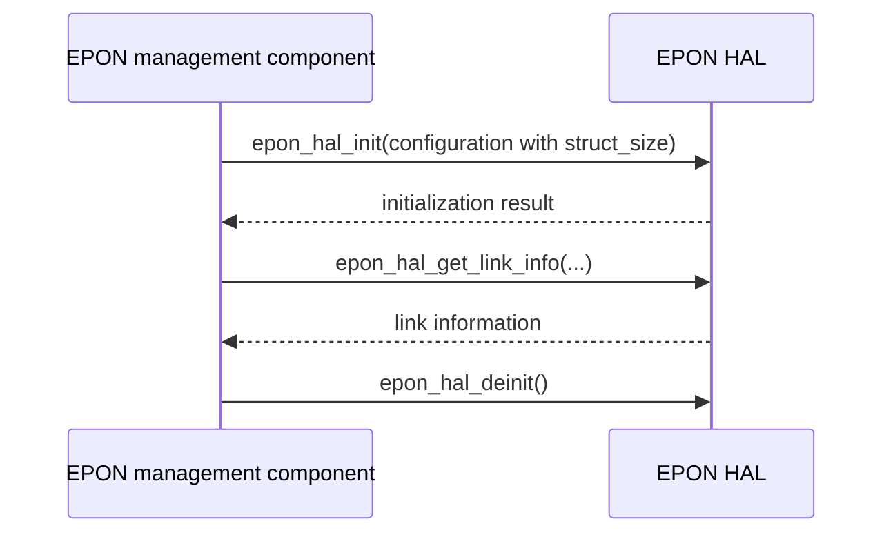

# EPON HAL Specification

## Version History

| Date | Comment | Version |
| --- | --- | --- |
| — | Public contract documentation. | — |

## Acronyms
HAL means Hardware Abstraction Layer; EPON means Ethernet Passive Optical Network; ONU means Optical Network Unit; OLT means Optical Line Terminal; LLID means Logical Link Identifier; DPoE means DOCSIS Provisioning of EPON.

## Description
The EPON management component uses this HAL for optical-link lifecycle, counters, identity, reset, and management operations.

## Optional Components
DPoE-specific functionality is conditional. Compile and test only the APIs enabled by the product's header configuration.

## Component Runtime Execution Requirements
### Initialization and Startup
Initialize the configuration structure as specified, including `struct_size = sizeof(configuration_object)`, and call `epon_hal_init` before dependent operations. Call `epon_hal_deinit` to release resources, callbacks, and OLT registration.
### Threading Model
Do not assume arbitrary concurrent calls are safe. Agree serialization and callback behavior with the vendor.
### Process Model
Use the library in the owning process; coordinate other management writers.
### Memory Model
Callers own supplied structures and buffers. Follow field capacities and structure-size conventions in the header.
### Asynchronous Notification Model
Initialization configures the callback relationship. Keep callback state valid through teardown; do not treat callback data as owned allocations unless explicitly documented.
### Blocking Calls
The initialization contract describes an error for exceeding three minutes. That limit must not be generalized to every operation.
### Internal Error Handling
Inspect each declared result; do not continue dependent operations after failed initialization. Reset, factory reset, and counter clearing are destructive operations.
### Persistence Model
Factory reset and provisioning may alter device state. Persistence, recovery, and restoration must follow product requirements.

## Nonfunctional Requirements
### Logging and Debugging
Implementations must not log credentials, secrets, security-sensitive information, or other sensitive data. Log operation outcomes rather than payloads.
### Quality Control
Use warning-clean builds, static analysis, and memory checks. Test structure-size handling, initialization failure, callbacks, and teardown against real implementations.
### Licensing
See repository license notices.
### Build Requirements
Compile against the root public header and link the product EPON implementation.
### Variability Management
Do not equate a declared optional function or enum value with implemented hardware support.

## Interface API Documentation
- `epon_hal_get_version`: report HAL version.
- `epon_hal_init`, `epon_hal_deinit`: establish and release the HAL lifecycle.
- `epon_hal_get_link_stats`, `epon_hal_get_transceiver_stats`: collect counters and optical diagnostics.
- `epon_hal_get_llid_info`: collect logical-link information.
- `epon_hal_get_manufacturer_info`: obtain device/vendor identity.
- `epon_hal_clear_stats`: clear statistics.
- `epon_hal_reset_onu`, `epon_hal_factory_reset`: reset the ONU or restore factory state.
- `epon_hal_get_link_info`, `epon_hal_get_interface_list`, `epon_hal_get_olt_info`: inspect link, interfaces, and upstream OLT.
- `epon_hal_set_oam_log_mask`: configure OAM logging.
- `dpoe_hal_get_cpe_mac_table`: retrieve the conditional DPoE CPE MAC table.

Each operation's argument directions, sizes, units, callback types, and return values are specified beside its declaration in the linked header.

### Theory of Operation and Key Concepts
Logical-link state, optical diagnostics, and device identity are separate observations. A counter reset must not be inferred to reset the optical link.

### Sequence Diagram

## Source References
- [epon_hal.h](https://github.com/rdkcentral/rdkb-halif-epon/blob/develop/epon_hal.h)
